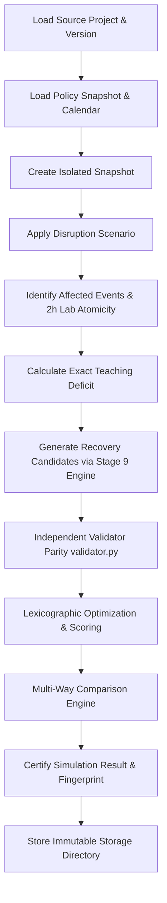

# Stage 10 Implementation Report: Holiday Closure Recovery & Timetable Simulation Engine

**Certification Marker**: `STAGE_10_PASS — HOLIDAY RECOVERY & TIMETABLE SIMULATION CERTIFIED`  
**Status**: `PASS`  
**Automated Tests**: 132 / 132 Passed (100%)  
**Simulation Engine Version**: `10.0.0`  
**Generation Engine Version**: `9.0.0`  

---

## 1. Executive Summary
Stage 10 builds an institutional-grade deterministic recovery and what-if simulation architecture on top of the certified Stage 9 generation engine. It provides academic administrators with the capability to model complex calendar disruptions—ranging from institutional holidays and weather emergencies to localized room maintenance and faculty leave—accurately evaluate the resulting instructional deficit, and generate constraint-compliant recovery candidates without altering certified production schedules or mutating canonical projects.

---

## 2. Architecture & Pipeline
The simulation pipeline operates through 17 deterministic stages:


---

## 3. Disruption Scenarios & Calendar Modeling
- **Supported Disruption Types**:
  - `HOLIDAY`: Full institutional day closure.
  - `INSTITUTIONAL_CLOSURE`: Campus-wide planned closure.
  - `EMERGENCY_CLOSURE`: Exceptional urgent closure.
  - `CANCELLED_TEACHING_DAY`: Academic day cancellation.
  - `PARTIAL_DAY_CLOSURE`: Closed slots within specific hours (e.g. morning/afternoon).
  - `ROOM_UNAVAILABLE`: Temporary room closure/renovation.
  - `FACULTY_UNAVAILABLE`: Faculty leave or medical absence.
  - `SECTION_UNAVAILABLE`: Student section excursions/internships.
  - `BUILDING_UNAVAILABLE`: Entire academic or laboratory block closure.
  - `CUSTOM_SCENARIO`: Configurable multi-variable disruption.
- **Calendar Precedence**:
  1. Explicit Date Exception
  2. Institutional Closure
  3. Holiday
  4. Recurring Calendar Rule (including Friday post-lunch closure)
  5. Normal Calendar Working Hours
- **Lab Atomicity Invariant**: 2-hour lab sessions cannot partially overlap a closure window. If either hour intersects a closed slot, the entire 2-hour session is treated as affected and rescheduled atomically.
- **Multi-Entity Synchronization**: Shared multi-section courses and co-taught courses are synchronized atomically.

---

## 4. Deficit Calculation & Recovery Modes
- **Deficit Metrics**:
  - Affected Master Events count
  - Event-Hours lost
  - Student Section-Hours lost
  - Faculty-Hours lost
  - Room-Hours lost
  - Affected Labs count
  - Affected Shared Multi-Section & Multi-Faculty Events count
  - Full multidimensional breakdowns by day, section, and faculty.
- **Recovery Strategies**:
  - `DIRECT_RESCHEDULE`: Shifts affected events into alternative available slots.
  - `DISTRIBUTED_RECOVERY`: Distributes teaching hours across available days to minimize daily load imbalance.
  - `SAME_WEEK_RECOVERY`: Preserves the pedagogical coherence of the target teaching week.
  - `EXTENDED_WINDOW_RECOVERY`: Utilizes future scheduled makeup windows.
  - `NO_RECOVERY`: Formally reports unrecoverable teaching hours without creating an illegal timetable.

---

## 5. Stage 9 Generation Engine Integration
Recovery candidates are generated by translating scenario disruptions into hard blocked slots and executing the certified Stage 9 `TimetableGenerationEngine`.
- **Zero Hard Constraint Relaxation**: Room clashes, faculty clashes, and section clashes remain strictly zero.
- **Independent Validation**: All generated candidates are verified using the authoritative `validator.py`.
- **Lexicographic Optimization Order**:
  1. `HARD_FEASIBILITY`
  2. `MINIMIZE_UNRECOVERED_DEFICIT`
  3. `MINIMIZE_ADDITIONAL_STUDENT_DISRUPTION`
  4. `MINIMIZE_ADDITIONAL_FACULTY_DISRUPTION`
  5. `MINIMIZE_ADDITIONAL_ROOM_DISRUPTION`
  6. `MINIMIZE_DAY_CHANGES`
  7. `MINIMIZE_SLOT_DISPLACEMENT`
  8. `MINIMIZE_GAPS`
  9. `MINIMIZE_EXCESSIVE_RUNS`
  10. `MINIMIZE_DAILY_LOAD_IMBALANCE`
  11. `MINIMIZE_PREFERENCE_PENALTIES`

---

## 6. Storage Isolation & Reproducibility
Every simulation run creates an isolated immutable structure under `projects/simulations/<simulation_id>/`:
```
projects/simulations/<simulation_id>/
├── simulation_request.json
├── simulation_result.json
├── input/
│   └── source_fingerprint.json
├── scenarios/
│   └── scenario.json
├── disrupted/
│   └── disrupted_timetable.json
├── recovery/
│   └── recovery_candidates.json
├── validation/
│   └── validation_results.json
├── comparison/
│   └── comparison.json
├── exports/
└── logs/
    └── diagnostics.json
```
- **Determinism**: Given the same source timetable fingerprint, scenario, policy snapshot, and seed, the resulting simulation fingerprint is byte-identical.
- **Audit Logging**: Append-only audit records log `SIMULATION_STARTED`, `SIMULATION_COMPLETED`, and `SIMULATION_FAILED`.

---

## 7. Golden Invariants & Integrity
All golden schedule files and original FET sources were checked before and after all test executions:
- `production_schedule.json`: `fc77f694acd4eaad55cdbc18432b231e10bc46124cd4ac930bdc26369eb45c3b` (PASS)
- `stage5_3_corrected_optimized_schedule.json`: `8c82c3a36bce6655b78344c599ba7911b4e318ba96fc541d679c06a8bdc0708a` (PASS)
- `production_schedule.csv`: `47a555a3267a354d6b34548f76d9857d771925a603ff7998bdf0e2510ac67643` (PASS)
- Source timetable mutation: **NONE** (Certified read-only guarantee).
